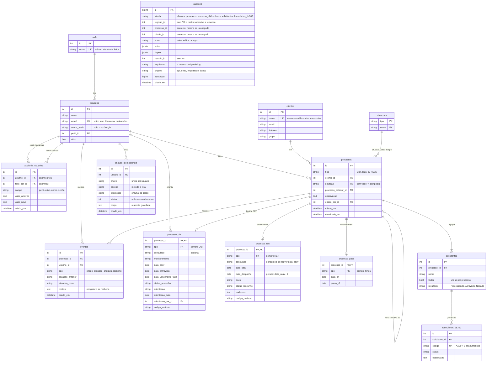

# Diagrama entidade-relacionamento (DER)

> Todos os dados deste repositório são fictícios. O GitHub desenha o diagrama abaixo sozinho.
> Fonte da verdade: [app/models.py](../app/models.py) e as migrations em [migrations/versions/](../migrations/versions/).

Além das tabelas, existe a **view `vw_painel_processos`** (migration 0003, ampliada na 0005): uma linha por
processo, no formato da planilha da operação. Ela junta clientes, o detalhe do tipo, os solicitantes (contados
e resumidos num resultado geral) e a orientação. A rota `GET /painel` lê dela.

## Como ler as relações

- **Herança de tabela unida.** `processos` guarda o que é comum; `processo_obt`, `processo_ren` e
  `processo_pass` guardam o que é de cada tipo. A FK composta `(processo_id, tipo)` impede, por exemplo, um
  detalhe de REN ligado a um processo OBT.
- **FK composta para a situação.** `(tipo, situacao)` aponta para `situacoes`: o banco, e não o código, decide
  quais situações existem para cada tipo (`Pix` só em passaporte, `Entrevista` só em renovação).
- **1:N.** A tabela do lado "muitos" guarda o id do lado "um" (`solicitantes.processo_id`). A quantidade de
  solicitantes é contada, não armazenada.
- **Auditoria sem chave estrangeira.** `auditoria` é preenchida por trigger em cada tabela auditada e não
  aponta para elas: quando um cliente é apagado, o histórico dele continua lá (`cliente_id` e `processo_id`
  guardam o contexto). Só aceita INSERT. Fica fora do diagrama de relações de propósito.
- **Auto-relação.** `processos.processo_anterior_id` liga uma nova tentativa à negativa anterior do mesmo cliente.
